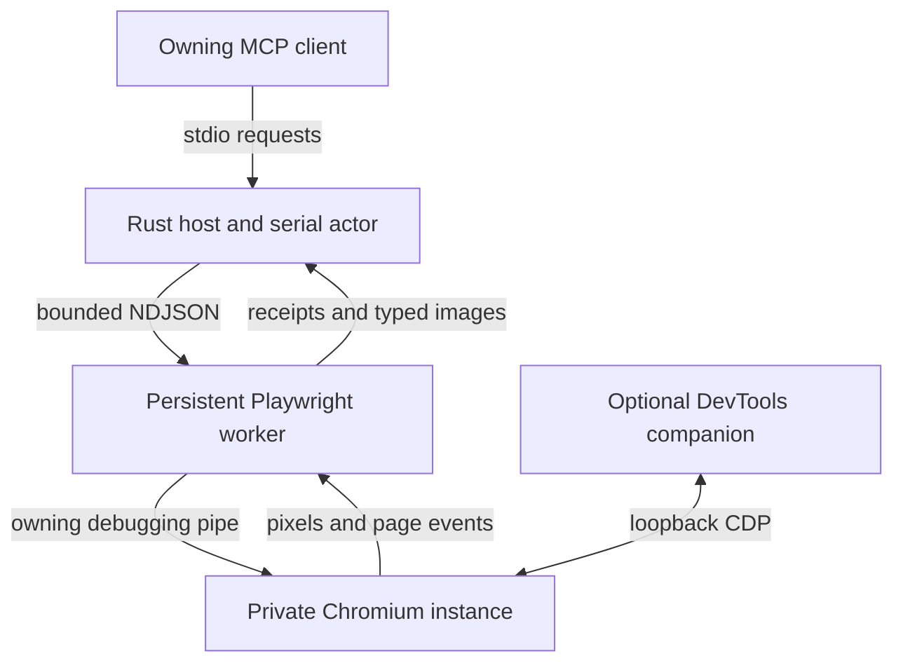
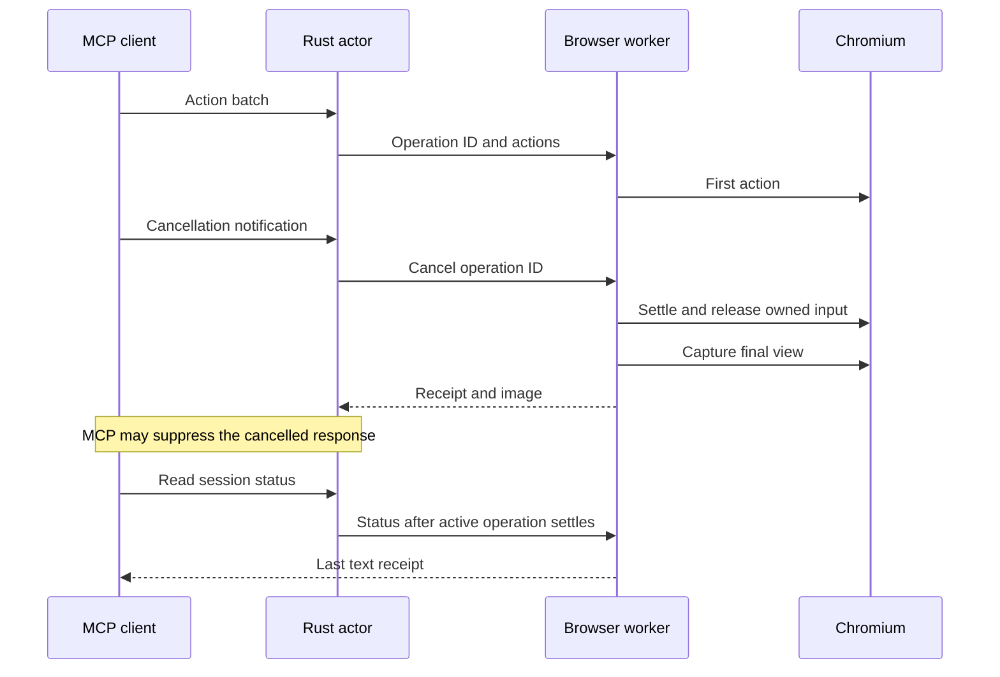

# Architecture

## Ownership and boundaries

One MCP process belongs to one owning client/thread. It lazily creates one Node
worker. That worker owns a persistent Playwright context and its pages until an
explicit close/reset, process shutdown or browser failure.

Rust owns MCP framing, version handling, static tool advertisement, admission,
cancellation propagation and process supervision. The worker owns DOM semantics,
input, page identity, screenshots, responsive review and retained diagnostics.
Browser code stays in Playwright instead of duplicating its locator, input and
browser behavior in a second Rust implementation.

The toolkit supplies RMCP types, stdio service lifecycle, list pagination and
process-group primitives. The browser supervisor uses Tokio directly for stdin
and stdout because this worker needs a bidirectional framed channel. A general
process runner without worker stdin would not be a useful abstraction here.

## State lifetime

The live context is the continuity boundary. Merely keeping the Node process
alive would not preserve a menu or an unsaved form if each tool call still
created a new context. `BrowserRuntime` retains the actual context, page objects,
listeners, profile reservation and selected page.

| State | Lifetime |
| --- | --- |
| MCP catalog | Compiled into the Rust host; no browser launch required. |
| Node worker | One per host, launched lazily. |
| Default profile | Private temporary directory reserved for that worker. |
| Explicit profile | Operator-owned, exclusively locked for that worker. |
| Browser instance ID | Changes on each explicit launch generation. |
| Page ID | Includes the instance generation and a unique page counter. |
| Observation ID | Identifies one capture on one page in one generation. |
| Input ownership | One operation, with explicit cleanup/recovery accounting. |
| Console/network history | Per-page bounded ring while that page is alive. |
| Last operation receipt | Bounded text only; replaced by the next relevant operation. |

An unexpected browser disconnect changes lifecycle to `lost`. A read-only status
call remains available, while browser work requires an explicit reset. Worker
protocol failure retires the Node process and requires a new host. Neither path
repeats the last action.

## Serialization includes the final observation

The Rust actor admits at most one active worker request and bounds its admission
queue. The worker also serializes browser operations; cancellation messages use
a separate control path that marks an operation without running a second browser
operation beside it. The active operation retains ownership through action
settlement, input cleanup and capture.

This prevents a misleading result where call A acts, call B changes the page,
and A returns B's screenshot. A client dropping its Rust request future requests
cancellation without dropping the actor's active operation. A late cancellation
acknowledgment is tracked as a control response and cannot be mistaken for the
next tool result.

The deadline is a cancellation budget, not a rollback guarantee. An input or
navigation can take effect before a timeout is reported. Playwright operations
that do not support cancellation must settle or reach their bounded action
timeout; only then can ordinary queued work continue. If the worker does not
settle within the host's grace window, the host retires it.

### Native dialogs

A native JavaScript dialog can suspend Chromium's response to input and frame
capture. The worker retains a tracked continuation for that input and returns an
explicit `blocked` receipt, the dialog text and `observation_unavailable`.
It reports cleanup as pending; it does not abandon an untracked promise or claim
an input release that has not happened. Ordinary browser mutations are fenced
until dialog resolution settles the original input and its cleanup. Status,
inspection and session recovery remain available. A resolving dialog action
returns recovery details before any later ordinary action can proceed.

A retained CDP Page event monitor also observes a dialog closed by a companion.
That event schedules reconciliation through the worker queue, settles the tracked
input and releases its owned inputs. `last_operation.dialog_recovery` records
the closure source and cleanup outcome. A later redundant accept returns
`NO_DIALOG` without leaving the mutation fence stuck.

## Cancellation reconciliation

`last_operation` lets a sequential client determine what completed before
cancellation even when the MCP SDK suppresses the original response. It retains
no image data and is not a durable ledger. Reconcile it before another mutating
call, then get a fresh observation. For multi-tenant or multiplexed use, a future
service would need explicit owners, operation IDs visible to each caller and a
bounded receipt ledger; this process is intentionally scoped to one owner.

## Observations and coordinates

An observation returns ordinary MCP text plus image blocks. A screenshot records
its own pixel size, viewport size, scroll and pixel-to-CSS mapping. The control
map is compact and ranked; it includes known labels, semantic locators, focus,
disabled state and a coarse covered/offscreen indication.

Before coordinate dispatch, the worker checks the latest observation, page
generation/navigation and current viewport geometry. This detects obvious
mismatches, including a review having resized the page. It does not freeze DOM
layout or prove that a moving control stayed at the same coordinate. Semantic
locators remain preferable when available.

`browser_step` also exposes an explicit `resize` action that sets the page's
persistent CSS viewport size and optional vertical scroll position. The final
observation reports measured viewport, scroll and image geometry; it does not
change user agent, touch input or device scale factor. A resize can trigger
application-visible resize handlers and is not automatically rolled back.

Capture and control-map reads are sequential observations of a running page.
Geometry instability is explicitly reported and disables coordinate actionability.
They are not a transactional DOM snapshot. The worker does not execute caller-
supplied JavaScript to generate the map.

Responsive review deliberately changes geometry. Each image describes the
geometry at capture time. Restoring the old viewport and scroll is reported
separately from application state; resize handlers, lazy loading and navigation
cannot be reversed by setting the viewport back.

## Images, live data and caching

The Rust adapter preserves `content` image blocks and omits `structuredContent`.
This avoids the supplied Codex revision's structured-content precedence hiding
the screenshot. Code Mode callers still need to forward the image block to the
model; the server instructions state that explicitly.

Live browser observations and tool results are never cached. Modern list results
declare private zero-lifetime cache hints. The last text receipt is operational
reconciliation state and is not substituted for a new tool result or image.
Image output is bounded per image, with PNG preferred and JPEG/CDP fallbacks.

## Lightweight diagnostics and optional CDP

Console and network listeners start when a page is registered. A 512-event ring
retains recent history between calls. Network completions receive new sequence
numbers so a cursor does not miss an update to a request that started earlier.
The inspector excludes request headers, response bodies and arbitrary evaluation;
known configured service-header values are redacted from text.

CDP is opt-in, loopback-only, and belongs to this worker's browser. The owning
Playwright connection remains the debugging pipe. Public tab metadata exposes
actual target IDs rather than asking a companion to choose a page by URL.
An attached diagnostic companion can still mutate the page outside the worker's
queue; the architecture does not pretend otherwise.

## Deliberate scope

The first version implements visual operation and basic retained diagnostics.
It does not add a shared browser daemon, browser-pool scheduler, arbitrary
JavaScript tool, file-upload/download workflow, full DevTools profiler, extension
host, cross-process auth broker or mobile-device emulation. The `browser_step`
resize action leaves the requested CSS viewport in place; only `browser_review`
attempts to restore prior viewport and scroll. Neither operation claims mobile
user-agent/touch/device emulation. These can be added when a concrete workflow
requires them without changing the core one-owner lifecycle.
